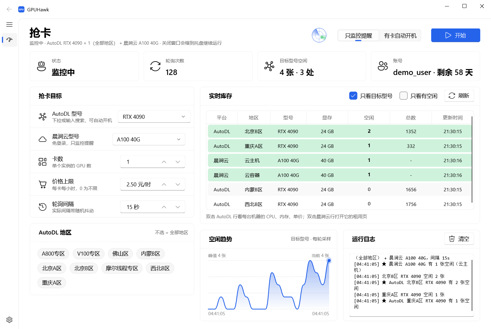
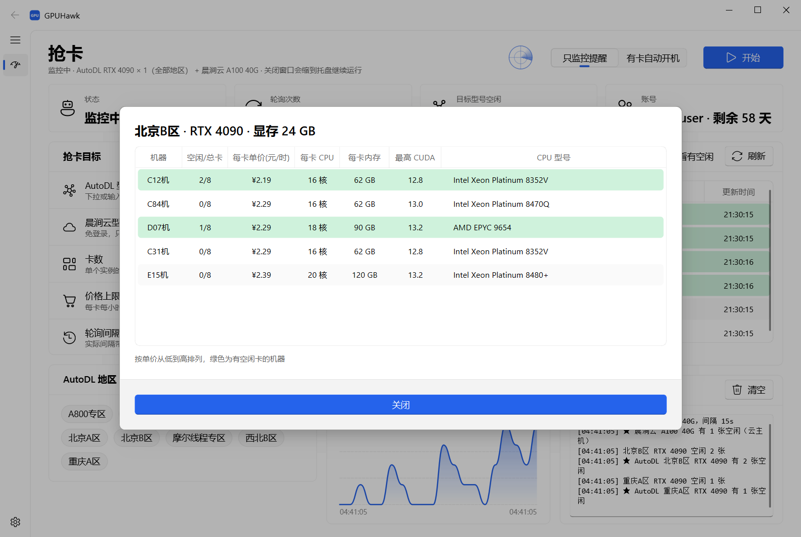
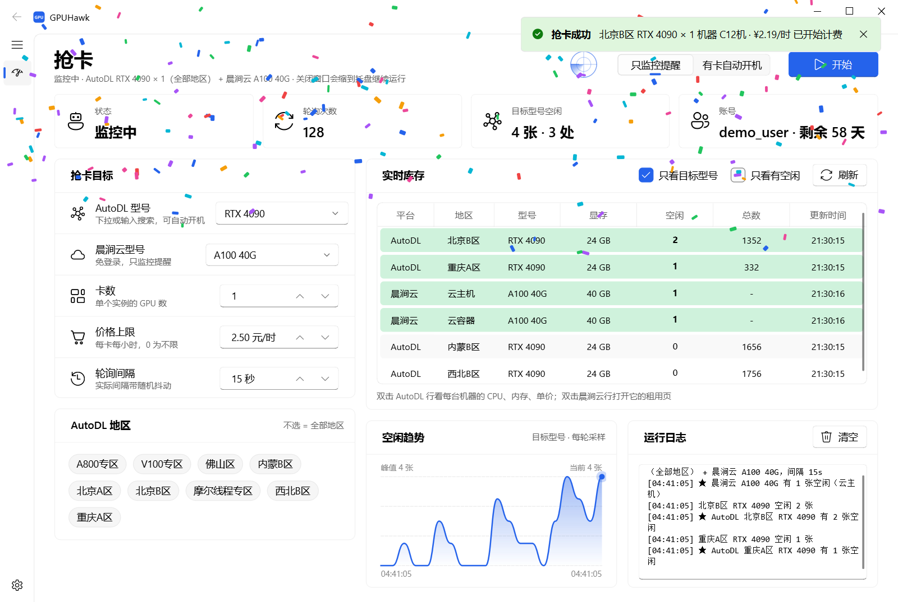
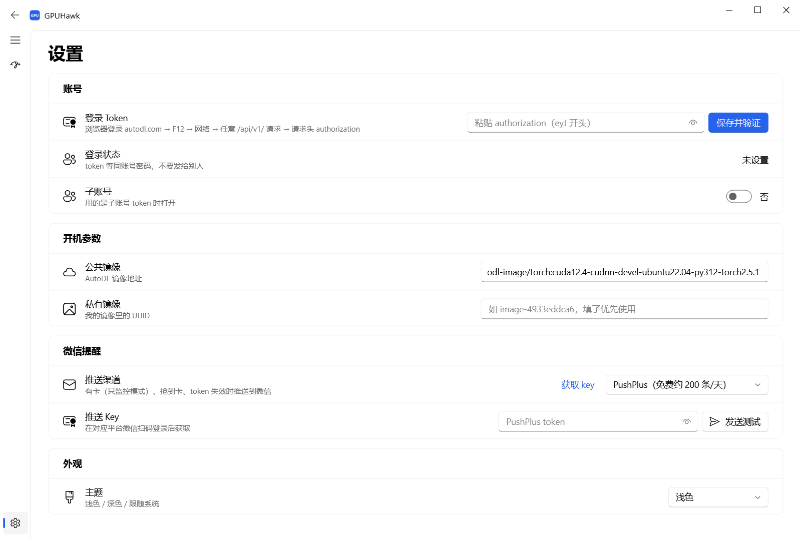

<div align="center">


# GPUHawk

**盯住 AutoDL / 晨涧云的空闲 GPU，有卡第一时间提醒，或者直接帮你开机。**

Windows 桌面客户端 · Fluent 界面 · 微信推送 · 单文件 exe


[](https://github.com/Kingpython123/GPUHawk/releases/latest)

</div>



## 为什么做这个

在 AutoDL 上想租一张 4090 / A800，经常一刷新就是 `0 / 1352`。GPUHawk 在后台替你一轮一轮地刷：

- **只监控提醒**：目标型号一有空闲，弹托盘通知、响铃、推送到微信；
- **有卡自动开机**：在 AutoDL 上直接按量计费开一台（只开一台，开到即停，可设单价上限）；
- **晨涧云一起盯**：晨涧云的库存接口免登录，选个型号就能和 AutoDL 一起监控。

## 功能

| | |
|---|---|
| 🦅 **多平台** | AutoDL（按地区、按型号）+ 晨涧云（云主机 / 云容器），同一张表里看 |
| 📊 **实时库存** | 每个地区每个型号的空闲 / 总数、显存；有空闲的行高亮 |
| 🔍 **机器明细** | 双击 AutoDL 一行，看每台机器的每卡 CPU、内存、单价、最高 CUDA、CPU 型号 |
| ⚡ **自动开机** | 只针对 AutoDL；价格上限、地区、卡数、镜像（公共 / 私有）可配；开机前二次确认 |
| 💬 **微信提醒** | PushPlus、WxPusher、Server酱、企业微信群机器人四选一，带「发送测试」 |
| 📈 **空闲趋势** | 每轮采样画曲线，看出这款卡什么时候容易放出来 |
| 🎨 **界面** | Win11 Fluent 风格、浅色 / 深色、雷达扫描动画、抢到时撒彩带 |
| 🧊 **托盘常驻** | 关窗口缩到托盘继续跑；设置、token 都保存在本机 |

<table>
<tr>
<td width="50%"><p align="center">双击一行看每台机器的配置和单价</p></td>
<td width="50%"><p align="center">抢到卡：通知 + 微信 + 彩带</p></td>
</tr>
<tr>
<td colspan="2"><p align="center">设置页：token、开机镜像、微信推送、主题</p></td>
</tr>
</table>

## 快速开始

### 方式一：直接用 exe

**[⬇ 下载 GPUHawk.exe](https://github.com/Kingpython123/GPUHawk/releases/latest/download/GPUHawk.exe)**（Windows 10/11，约 44 MB，不用装 Python），双击运行。历史版本见 [Releases](../../releases)。

首次运行如果被 SmartScreen 拦截，点「更多信息 → 仍要运行」（exe 没有数字签名）。

### 方式二：从源码运行

```bash
git clone https://github.com/Kingpython123/GPUHawk.git
cd GPUHawk
pip install requests "PySide6-Essentials>=6.8"
pip install --no-deps PySide6-Fluent-Widgets PySideSix-Frameless-Window darkdetect
python gpuhawk.py
```

> Fluent 组件库默认会拉完整版 PySide6 和 WebEngine（几百 MB），加 `--no-deps` 只装用得到的部分。

### 自己打包 exe

```bash
pip install pyinstaller
python -m PyInstaller --noconfirm GPUHawk.spec
```

产物在 `dist/GPUHawk.exe`（约 44 MB）。spec 里排除了 torch / numpy / scipy 等：Fluent 组件库会可选地引用它们，不排除的话环境里装了 torch 会被一起打进去，exe 变成几个 GB。

## 使用

### 1. 填 AutoDL token（只监控晨涧云可以跳过）

AutoDL 的库存和开机接口需要**网页登录态**，开发者 Token 不行：

1. 浏览器登录 [autodl.com](https://www.autodl.com)，按 `F12` 打开开发者工具 → 「网络」；
2. 随便点开一个 `/api/v1/` 开头的请求（比如 `gpu_type`），在请求头里找到 `authorization`；
3. 右键「复制值」（`eyJ` 开头的一长串），粘到 GPUHawk「设置 → 登录 Token」，点「保存并验证」。

token 保存在程序旁边的 `.env` 里，有效期约两个月，界面上会显示剩余天数。**它等同于账号密码，不要发给任何人。**

### 2. 选目标、开始

- **AutoDL 型号**：下拉或输入搜索；留空表示不监控 AutoDL；
- **晨涧云型号**：选「不监控」则不看晨涧云；
- 卡数、每卡价格上限、轮询间隔、地区（不选 = 全部）；
- 顶部切「只监控提醒 / 有卡自动开机」，点「开始」。

### 3. 微信提醒（可选）

「设置 → 微信提醒」选一个渠道，点「获取 key」去对应平台扫码，填好后点「发送测试」：

| 渠道 | 免费额度（以官网为准） | 推送到 |
|---|---|---|
| PushPlus | 约 200 条 / 天 | 个人微信（公众号消息） |
| WxPusher 极简推送 | 免费 | 个人微信 |
| Server酱 | 5 条 / 天 | 个人微信 |
| 企业微信群机器人 | 20 条 / 分钟 | 企业微信群 |

> PushPlus 如果「平台已接收」但微信没收到：去它官网的「发送结果查询」里查流水号。实测新建的「消息 token」有时投递失败，换成「用户 token」即可。

## 命令行

不想开界面也可以只用核心脚本（仅 AutoDL）：

```bash
set AUTODL_TOKEN=eyJ...
python gpuhawk_core.py --list-gpus
python gpuhawk_core.py --gpu "RTX 4090" --dry-run
python gpuhawk_core.py --gpu "RTX 4090" --num 1 --max-price 2.5 --region 北京B区 --push pushplus --push-key <token>
```

## 工作原理

没有官方开放 API，用的是两家网页前端自己调用的接口：

| 平台 | 用途 | 接口 | 登录 |
|---|---|---|---|
| AutoDL | 型号 / 地区 | `GET /api/v1/machine/gpu_type`、`/api/v1/region/list` | 否 |
| AutoDL | 各地区各型号空闲 | `POST /api/v1/machine/region/gpu_type` | 是 |
| AutoDL | 机器明细 | `POST /api/v1/user/machine/list` | 是 |
| AutoDL | 按量开机 | `POST /api/v1/order/instance/create/payg` | 是 |
| 晨涧云 | 各型号空闲 | `GET api.mornai.cn/app-api/{cloud,container}/resource/gpu/count`（头 `tenant-id: 1`） | 否 |

接口随网站改版可能失效；遇到报错欢迎提 issue。

## 注意

- **自动开机会立即按量扣费。** 只开一台、成功即停，开机前会二次确认，但请先用「只监控」确认一切正常，并设好价格上限。
- 轮询间隔默认 15 秒并带随机抖动，请不要调得过低，别给平台添麻烦。
- 自动化调用网页接口可能不符合平台的用户协议，请自行评估、合理使用。本项目与 AutoDL、晨涧云官方无关。

## 致谢

- [knight02-bit/AutoDL-monitor](https://github.com/knight02-bit/AutoDL-monitor)、[nicholasdezai/autodl-radar](https://github.com/nicholasdezai/autodl-radar)、[Jiayi-Fu/autodl-gpu-monitor](https://github.com/Jiayi-Fu/autodl-gpu-monitor)：AutoDL 接口参考
- [zhiyiYo/PyQt-Fluent-Widgets](https://github.com/zhiyiYo/PyQt-Fluent-Widgets)：Fluent 界面组件

## License

[GPL-3.0](LICENSE)（界面依赖的 PyQt-Fluent-Widgets 为 GPLv3）
